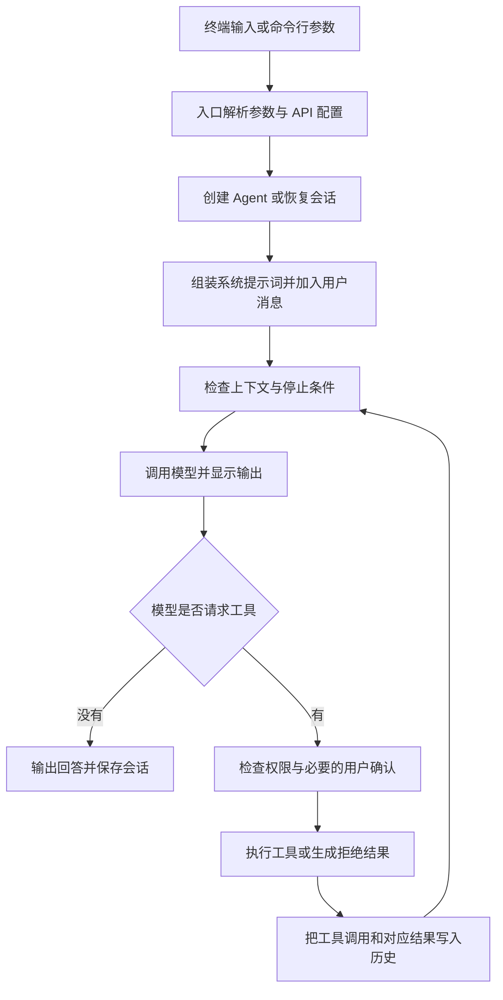

# Python 复刻学习流程：从命令行到 Coding Agent

本文基于当前项目的 `python/mini_claude/` 源码编写。学习目标是理解原理、逐步实现、逐步验证，并通过 GitHub 留下每一步的记录。

学习语言：Python 3.11 及以上。计划使用的公开仓库名：`mini-Claude-code`。

配套操作文档：[GitHub 代码管理入门](16-github-code-management.md)。先阅读本文的项目流程和阶段表，再按配套文档完成第 0 次提交。

## 1. 学完之后，你要能做什么

你将写出一个命令行编程助手：接收需求，调用模型，由模型选择工具，读取和修改文件，再根据工具结果继续工作，最终给出回答。随后逐步加入会话、流式输出、上下文压缩、记忆、技能、规划、子 Agent 和 MCP。

复刻完成的标准不是文件名和原项目相同，而是你能解释一次请求如何穿过系统，并独立修改其中一项能力。

## 2. 整个项目的运行流程



模型决定“调用什么工具、传什么参数”；Python 程序决定“是否允许、怎样执行、怎样记录结果”。模型本身不直接读取你的硬盘。

### 一次读取文件的具体过程

假设用户输入：“读取 README.md，告诉我怎么启动项目。”

1. CLI 将输入交给 `Agent.chat()`。
2. Agent 将用户消息加入历史，调用模型，同时提供工具定义。
3. 模型返回工具请求，例如 `read_file`，参数是 `{"file_path": "README.md"}`。
4. Agent 检查权限，通过工具执行器读取文件。
5. Agent 记录模型的工具调用，并用同一个调用 ID 回传文件内容。
6. 模型在下一次请求中看到文件内容，生成启动说明。
7. 没有新的工具调用时结束本次循环，正常完成后保存会话。

工具调用 ID 像订单号：一次请求必须与它自己的结果对应。遗漏、错配或压缩时拆散这一对消息，可能让 API 拒绝请求。

### 外围能力接在什么地方

| 能力 | 接入位置 | 解决的问题 |
|---|---|---|
| 系统提示词 | 构造模型请求时 | 让模型知道工作目录、规则和职责 |
| 权限 | 工具执行前 | 对操作作出允许、拒绝或确认决定 |
| 会话 | 对话结束与程序恢复时 | 继续上次对话 |
| 上下文压缩 | 模型调用前及用户轮次边界 | 控制消息长度，同时保持协议完整 |
| 记忆 | 提示词和相关信息召回 | 跨会话保存偏好和项目事实 |
| 技能 | 加载说明或执行技能时 | 复用操作流程 |
| Plan Mode | 提示词、工具权限与审批环节 | 先规划，再按审批结果执行 |
| 子 Agent | 特殊工具分发时 | 使用独立上下文处理子任务并返回结果 |
| MCP | 工具发现和调用分发时 | 连接外部工具服务 |

## 3. 源码地图与阅读方法

下列路径都相对于原项目根目录。学习仓库将只逐步加入自己实现的文件。

| 原项目文件 | 核心职责 | 第一次重点看什么 |
|---|---|---|
| `python/mini_claude/__main__.py` | 参数解析、API 配置、单次运行与 REPL | `main()`、`parse_args()`、`run_repl()` |
| `python/mini_claude/agent.py` | 模型调用、消息历史、工具循环、压缩、预算 | `chat()`、`_chat_anthropic()`、`_execute_tool_call()` |
| `python/mini_claude/tools.py` | 工具定义、执行函数与权限判断 | `tool_definitions`、`check_permission()`、`execute_tool()` |
| `python/mini_claude/prompt.py` | 项目规则、环境信息与系统提示词 | `build_system_prompt()`、`load_claude_md()` |
| `python/mini_claude/ui.py` | 输出文本、工具结果和状态 | 文本与工具结果的显示函数 |
| `python/mini_claude/session.py` | JSON 会话保存和加载 | `save_session()`、`load_session()` |
| `python/mini_claude/memory.py` | 记忆文件、索引、语义选择与异步预取 | 保存、列举、选择相关记忆的函数 |
| `python/mini_claude/frontmatter.py` | Markdown 头部配置解析 | 解析输入和返回结构 |
| `python/mini_claude/skills.py` | 技能发现、参数替换、inline/fork 执行 | `discover_skills()`、`execute_skill()` |
| `python/mini_claude/subagent.py` | 内置与自定义子 Agent 配置 | `get_sub_agent_config()` |
| `python/mini_claude/mcp_client.py` | JSON-RPC、进程通信与工具发现 | `McpConnection`、`McpManager` |
| `python/pyproject.toml` | 版本要求、依赖、命令行入口 | Python 版本、dependencies、scripts |

第一遍只追踪这条调用链：

```text
__main__.main
  → Agent.chat
    → Agent._chat_anthropic
      → 模型返回工具调用
      → Agent._execute_tool_call
        → tools.execute_tool
      → 记录工具结果，再调用模型
```

`skill`、`agent`、Plan Mode 和 MCP 由 Agent 层作特殊分发，不是所有工具都直接进入普通文件工具执行器。

原项目 `docs/00-introduction.md` 到 `docs/14-testing.md` 是原理参考。本学习路线会调整实现顺序：先实现一种后端和非流式最小循环，再加入复杂能力。

## 4. 工作目录与学习节奏

原项目用作参考，复刻代码放在单独的学习目录：

```text
claude-code-from-scratch-main/        ← 原项目
├── python/                          ← 阅读参考
├── docs/                            ← 本文及原教程
└── learning/
    └── mini-Claude-code/            ← 你的独立 Git 仓库
        ├── README.md
        ├── LICENSE
        ├── .gitignore
        ├── docs/
        └── mini_claude/             ← 第 1 阶段起逐步创建
```

在 `learning/mini-Claude-code/` 初始化 Git，避免第一次提交就混入原项目全部实现。原项目根目录目前没有 `.git`，不等于里面的代码需要全部成为你的学习起点。

每个阶段固定做六件事：

1. 先说清楚这一步的输入、输出和目标。
2. 阅读对应的小段源码，画出调用关系。
3. 在自己的目录实现最小版本。
4. 运行正常场景与本阶段关键异常场景。
5. 在 README 或学习笔记里记录结果和一个疑问。
6. 查看 diff，提交到本地，推送 GitHub，再核对远程提交。

如果一步太大，可分成几个提交；不必为了表格强行把整阶段塞进一个提交。每个提交只讲一件事。下面的提交信息是建议，不代表已经执行。

## 5. 分阶段实现计划

### 阶段 0：建立学习仓库

- **要理解**：Git 与 GitHub 的区别，工作区、暂存区和提交的关系。
- **要写**：README、忽略规则、学习文档、来源与许可证说明。
- **验收**：`git log --oneline` 有第一条提交；推送后 GitHub 能看到相同提交。
- **参考**：配套 GitHub 指南；原项目 `LICENSE`。
- **提交**：`docs: add Python rebuild learning plan`。

### 阶段 1：做出能运行的 CLI

- **要理解**：Python 包、`__main__.py`、`argparse`、入口函数。
- **要写**：`mini_claude/__init__.py` 和 `mini_claude/__main__.py`，只回显输入。
- **验收**：`python -m mini_claude "你好"` 正常输出；`--help` 显示帮助；缺少必填参数时有提示。
- **参考**：`__main__.py` 的参数解析；本文第 6 节。
- **提交**：`feat: add CLI skeleton`。

### 阶段 2：调用一次真实模型

- **要理解**：API Key、模型名、请求、响应、`async` / `await`。
- **要写**：`pyproject.toml` 与最小模型客户端。先接入你实际有权限使用的一种后端，再接第二种。
- **验收**：一个问题返回真实回答；缺少 Key 时显示明确错误；不会把 Key 打印出来。
- **参考**：`__main__.py` 的 API 配置与 `agent.py` 的客户端初始化。
- **提交**：`feat: add a model client`。

先确认服务商、协议和可用模型，再填写配置。源码默认模型名不代表你的账号一定能调用。原项目通过环境变量取 Key，不能只把 Key 写进 `.env` 就假定它会自动加载。

### 阶段 3：多轮对话与交互输入

- **要理解**：终端输入循环与 Agent 工具循环是两件事；消息历史让模型获得上文。
- **要写**：最小 `Agent` 类、消息列表、REPL、`exit` 和 `/clear`。
- **验收**：先说“记住数字 42”，再问“刚才的数字是什么”；清空后检查旧消息已移除。空输入和输入结束能妥善处理。
- **参考**：`run_repl()`、`Agent.chat()`、`clear_history()`。
- **提交**：`feat: add conversation history and REPL`。

### 阶段 4：定义工具与只读执行器

- **要理解**：工具名称、参数 schema 与 Python 实现之间的对应关系。
- **要写**：`tools.py`，先实现 `read_file`，再加 `list_files`，并统一返回结果格式。
- **验收**：先绕过模型直接调用工具函数；正常文件读取正确，不存在的文件和未知工具返回可理解的错误。
- **参考**：`tool_definitions`、`_read_file()`、`execute_tool()`。
- **提交**：`feat: add read-only tools`。

### 阶段 5：接通 Agent Loop

- **要理解**：用户消息 → 模型工具请求 → 执行结果 → 再次请求模型。
- **要写**：非流式工具循环、调用 ID 配对、工具错误回传、简单的最大轮次限制。
- **验收**：让模型读取仓库内的说明文件并总结；检查日志中至少发生一次工具调用和后续回答。连续调用达到轮次限制时能停止。
- **参考**：`_chat_anthropic()` 或 `_chat_openai()`，只看你选用的一条路径。
- **提交**：`feat: implement the agent tool loop`。

### 阶段 6：写入、编辑、搜索、Shell 与权限

- **要理解**：权限必须由程序检查；提示词里写“不要修改”不足以阻止修改。
- **要写**：先加允许/拒绝/确认，再逐个加入 `write_file`、`edit_file`、搜索与 Shell。补上超时、读取后修改检查、外部修改检测。
- **验收**：在专用练习文件上验证允许和拒绝；拒绝后文件内容不变；旧内容匹配不唯一时不误改；Shell 超时可结束；外部修改后要求重新读取。
- **参考**：`check_permission()`、`execute_tool()`、mtime 检查和编辑函数。
- **提交示例**：`feat: guard file edits with permission checks`、`feat: add search and shell tools`。

原项目的权限模式和正则检查属于教学实现，不是完整的系统沙箱。先使用普通确认模式学习，再单独理解其他模式。

### 阶段 7：系统提示词与项目规则

- **要理解**：系统提示词、用户输入和工具结果分别承担什么职责。
- **要写**：`prompt.py`，加入工作目录、基础规则、`CLAUDE.md`；之后再加 `@include`、规则目录和 Git 信息。
- **验收**：创建一条明显的项目约定并观察行为；文件不存在仍能启动；循环 include 不会无限递归。
- **参考**：`build_system_prompt()`、`load_claude_md()`、`_resolve_includes()`。
- **提交**：`feat: load project instructions into prompts`。

### 阶段 8：保存与恢复会话

- **要理解**：历史消息需要可序列化，并保持工具调用与结果完整。
- **要写**：`session.py`，保存 JSON、读取 JSON、`--resume`。
- **验收**：退出后重启继续前文；会话文件损坏有提示；恢复后仍可正常调用工具。
- **参考**：`save_session()`、`load_session()`、`restore_session()`。原项目会话默认放在用户目录的 `.mini-claude/sessions/`。
- **提交**：`feat: persist and resume sessions`。

### 阶段 9：流式输出、中断和重试

- **要理解**：文本增量与工具参数增量不同；参数没接收完整时不能执行工具。
- **要写**：流事件解析、实时显示、取消机制、有限重试；再考虑只读工具的并行与提前执行。
- **验收**：长回答逐步出现；中断后停止后续工具动作；模拟临时失败可重试；重试不重复执行已完成的写操作。
- **参考**：`_call_anthropic_stream()` / `_call_openai_stream()`、`abort()`、`_with_retry()`。
- **提交示例**：`feat: stream model output`、`feat: support cancellation and retries`。

### 阶段 10：上下文与预算管理

- **要理解**：会话保存不等于上下文压缩；费用估算不等于服务商实际账单。
- **要写**：token 统计、轮次/费用限制、大工具结果保存、输出裁剪、旧结果清理、模型摘要。
- **验收**：长内容可通过文件再读取；压缩后保留用户目标与工具协议完整性；达到限制时能停止。
- **参考**：`_persist_large_result()`、`_run_compression_pipeline()`、`_check_and_compact()`、`_check_budget()`。
- **提交**：`feat: manage context and execution budgets`。

### 阶段 11：跨会话记忆

- **要理解**：会话存的是对话，记忆存的是值得跨对话保留的信息。
- **要写**：`memory.py`；先实现保存、列举和读取，再实现相关记忆选择与异步预取。
- **验收**：保存一条学习偏好，新会话能召回；不相关的记忆不会全部塞入提示词；没有记忆时也正常运行。
- **参考**：记忆索引、`select_relevant_memories()`、`start_memory_prefetch()`。
- **提交**：`feat: add persistent memory`。

### 阶段 12：技能与头部配置

- **要理解**：技能是可复用的说明和流程；inline 注入当前上下文，fork 使用子 Agent。
- **要写**：`frontmatter.py`、`skills.py`，先实现技能发现、描述和参数替换；fork 等子 Agent 完成后补齐。
- **验收**：能发现并手动调用一个简单技能；参数替换正确；配置错误有可理解的处理结果。
- **参考**：`discover_skills()`、`resolve_skill_prompt()`、`execute_skill()`。
- **提交**：`feat: discover and invoke inline skills`。

### 阶段 13：Plan Mode

- **要理解**：计划状态、工具权限、计划文件和用户审批是一个完整流程。
- **要写**：进入/退出规划模式、计划展示、审批选择与状态切换。
- **验收**：规划阶段读取可用，业务文件写入和 Shell 被阻止；计划文件按规则处理；审批后才进入对应执行模式。
- **参考**：`toggle_plan_mode()`、`_execute_plan_mode_tool()` 与 CLI 审批回调。
- **提交**：`feat: add planning and approval flow`。

### 阶段 14：子 Agent 与 fork 技能

- **要理解**：子 Agent 拥有自己的任务、上下文和工具权限，完成后返回结果。
- **要写**：`subagent.py`、子任务入口、输出汇总，并接通阶段 12 的 fork 技能。
- **验收**：子 Agent 分析一个小目录并返回摘要；只读子 Agent 不能写文件；失败或取消能回到主流程。
- **参考**：`get_sub_agent_config()`、`_execute_agent_tool()`、`run_once()`。
- **提交**：`feat: add subagents and fork skills`。

### 阶段 15：第二后端、延迟工具和 MCP

- **要理解**：不同模型协议的消息格式不同；MCP 是外部工具连接协议，不是更换模型。
- **要写**：第二种后端及消息适配；按需激活工具；`mcp_client.py` 的连接、握手、发现和调用。
- **验收**：同一读取任务分别通过两种已配置后端完成；延迟工具激活后才加入请求；MCP 测试服务的加法工具返回 `42`；服务退出不会让程序无限等待。
- **参考**：`_to_openai_tools()`、活动工具定义、`McpConnection`、`McpManager`、`test/mcp-server.cjs`。
- **提交示例**：`feat: add a second model backend`、`feat: discover deferred tools`、`feat: connect MCP tools`。

原项目的 MCP 测试服务是 Node.js 文件。选用它时需单独准备 Node 环境；此前的 Python 学习阶段不依赖 Node。

### 阶段 16：整理成可复现的项目

- **要理解**：别人能运行你的项目，才算完成交付。
- **要写**：安装说明、配置示例、功能范围、限制、代表性验证记录。
- **验收**：从 GitHub 克隆到新目录，按 README 建环境并运行；覆盖对话、读取、编辑拒绝、恢复、中断和 MCP 等关键路径。
- **参考**：原项目 `docs/14-testing.md`、`test/TEST-GUIDE.md`，按自己的实现调整命令，不直接照搬全部配置脚本。
- **提交**：`docs: document setup and validation results`。

## 6. 第一课逐步写：CLI 骨架

先按 GitHub 指南完成阶段 0。以下命令都在你的学习仓库根目录运行：

```powershell
Set-Location 'E:\vs_ai_workspace\claude-code-from-scratch-main\learning\mini-Claude-code'
python --version
New-Item -ItemType Directory -Path mini_claude
New-Item -ItemType File -Path mini_claude/__init__.py
```

Python 需为 3.11 或以上。如果目录或文件已存在，直接检查现有内容，不要覆盖。用 VS Code 新建 `mini_claude/__main__.py`，写入：

```python
import argparse


def main():
    parser = argparse.ArgumentParser(
        description="从零学习实现一个 Coding Agent"
    )
    parser.add_argument("prompt", help="你想告诉助手的话")
    args = parser.parse_args()

    print(f"收到你的请求：{args.prompt}")


if __name__ == "__main__":
    main()
```

逐行理解：`argparse` 处理命令行；`add_argument` 声明输入；`parse_args` 读取输入；`main` 是入口函数；最后两行让模块作为程序运行时进入入口。

验证：

```powershell
python -m mini_claude "你好，我正在学习 Agent"
python -m mini_claude --help
python -m mini_claude
```

第一条应输出 `收到你的请求：你好，我正在学习 Agent`；第二条应显示帮助；第三条应提示缺少 `prompt` 并以非零状态退出。这是预期的参数校验，不是程序故障。本课只验证入口和输入，不会调用模型。

在 README 记录以上结果，然后提交：

```powershell
git status
git diff
git add mini_claude/__init__.py mini_claude/__main__.py README.md
git diff --cached
git commit -m "feat: add CLI skeleton"
git push
```

在第 0 阶段首次推送并设置上游后，最后一行才可以直接使用 `git push`。

## 7. 每课复盘模板

在学习仓库新建 `docs/progress.md`，每课追加：

```markdown
## 阶段 N：标题

- 本次目标：
- 实现的文件与功能：
- 运行命令与实际结果：
- 异常场景的结果：
- 我对调用流程的解释：
- 尚未解决的问题：
- Git 提交：填写 git log 显示的短哈希
- GitHub 核对：已看到对应提交 / 尚未推送
```

已实际运行才写“通过”，只完成本地提交时不要写“已上传”。完成一课后，至少能够回答：输入从哪来、状态存在哪、下一步由谁决定、错误怎样返回。

## 8. 学习进度

本文是计划与练习说明，不代表下面的阶段已经实现。

- [ ] 0 学习仓库与第一次推送
- [ ] 1 CLI 骨架
- [ ] 2 单次模型调用
- [ ] 3 多轮对话
- [ ] 4 只读工具
- [ ] 5 Agent Loop
- [ ] 6 编辑、搜索、Shell 与权限
- [ ] 7 系统提示词
- [ ] 8 会话恢复
- [ ] 9 流式、中断和重试
- [ ] 10 上下文与预算
- [ ] 11 记忆
- [ ] 12 技能
- [ ] 13 Plan Mode
- [ ] 14 子 Agent 与 fork
- [ ] 15 第二后端、延迟工具与 MCP
- [ ] 16 文档和完整验证
