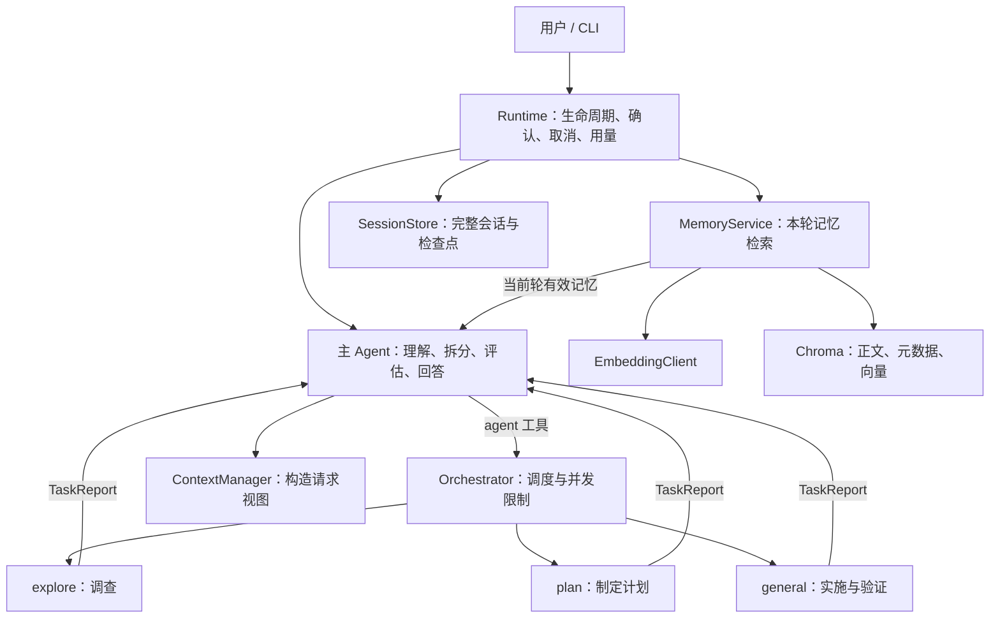

# Mini Claude Code 从零重写计划：多 Agent + Chroma

## 1. 重写决定

用户已明确要求：旧实现不再作为基础，从零规划和编写。本文取代此前的改造路线与零散待办。

- 新版根目录为 `rebuild/`，不导入或复制旧版生产代码和测试。
- 目标按用户截图的四个模块组织，长期记忆的存储改为 Chroma。
- 每个阶段先说明结构与数据流，再完成模块、测试和验收；不再按临时新增一个参数的方式推进。
- 旧版文件保留为学习记录；新版使用独立环境、独立运行数据和独立测试目录。
- 当前只完成规划。下文所有功能均为目标，未标为完成的阶段都尚未实现。

## 2. 最终交付的四个模块

| 模块 | 最终行为 |
| --- | --- |
| 多 Agent | 主 Agent 拆分任务，委派 explore / plan / general 子 Agent；独立任务有界并发，主上下文只接收报告 |
| 语义记忆 | project / user / task / general 四类记忆存入 Chroma；Embedding 检索、元数据过滤、按轮异步预取和有效期检查 |
| 工具 | 10 个核心工具；文件编辑防护；超过 30 KiB 的结果完整落盘并返回预览和读取方式 |
| 上下文与会话 | 大结果落盘加模型摘要；请求窗口最多保留最近 100 个用户轮次；完整会话有序异步保存并支持恢复 |

“实现这些行为”是验收目标；工具数量、线程池和后台任务本身不代替功能验收。

## 3. 系统结构与职责



| 组件 | 负责 | 对外提供的主要结果 |
| --- | --- | --- |
| Agent | 一套通用的“请求模型 → 调用工具 → 继续或结束”循环 | TaskReport |
| Orchestrator | 新建子任务、角色约束、并发上限、结果归属与取消 | 按 task_id 对应的子任务报告 |
| ToolRegistry | 工具定义、参数校验、路由到处理函数 | 统一 ToolResult |
| MemoryService | 保存、检索、范围与有效期过滤、按轮预取 | MemoryRecord / MemoryContext |
| ChromaMemoryStore | 操作 Chroma；不参与聊天循环 | 记录、候选 ID、距离 |
| ContextManager | 组合角色提示、摘要、近期历史与当前记忆 | 实际发送给模型的消息 |
| SessionStore | 完整历史、原子写入、恢复与协议验证 | 会话快照 |
| Runtime | 客户端、异步任务、I/O 线程池、统一确认、用量与退出 | 生命周期和共享服务 |

共享 Runtime 服务不等于共享聊天上下文。每个 Agent 拥有自己的 messages、文件读取记录和摘要。

## 4. 先固定的数据约定

| 数据 | 必要内容 | 为什么单独定义 |
| --- | --- | --- |
| TaskRequest | task_id、角色、任务说明、必要背景、程序授予的权限 | 明确子任务输入；不复制主会话 |
| TaskReport | task_id、状态、摘要、证据位置、变更与验证、未完成事项 | 主 Agent 依据报告继续工作；过程留在子任务中 |
| ToolResult | 成功/失败、正文或预览、可选结果文件引用 | 所有工具按同一协议进入模型历史 |
| MemoryRecord | ID、类型、标题、正文、作用域、版本、时间与有效期 | 隔离业务记忆与 Chroma 返回格式 |
| TurnContext | session_id、turn_id、上下文版本、会话可见记忆 ID | 防止预取结果跨轮或跨压缩版本注入 |

子任务状态至少区分 completed、partial、failed、cancelled，达到轮次上限不自动等于任务成功。

## 5. 多 Agent 的明确边界

### 5.1 主 Agent 与三类子 Agent

| 角色 | 工作 | 工具范围 |
| --- | --- | --- |
| main | 理解问题、拆任务、委派、评估报告和回答 | agent、save_memory、search_memory |
| explore | 查找入口、阅读代码、定位证据 | read_file、list_files、grep_search、web_fetch |
| plan | 调查现状，形成步骤、文件范围和验证方案 | 与 explore 相同；返回计划文本 |
| general | 完成明确的实现或验证任务 | 7 个文件、搜索、网页与 Shell 工具；写操作继续受用户权限约束 |

简单问答由 main 直接回答。项目文件操作由子 Agent 执行。首版禁止子 Agent 再创建子 Agent。

fork-return 表示新建隔离上下文并等待报告，不调用操作系统 fork，也不默认复制主历史。子 Agent 接收明确的任务、目录和必要资料。

### 5.2 权限与计划

- 用户控制 default / read_only / plan 模式，程序不自动切换模式。
- 实际权限同时受角色白名单、用户模式和当前计划审批约束；委派不能扩大权限。
- plan 子 Agent 返回计划，Runtime 中的计划流程负责展示、保存与审批，不额外增加模型工具。
- 审批绑定具体计划版本；写入前检查审批仍有效。确认窗口由统一入口串行展示。
- 子 Agent 的上下文独立，但工作目录共享。首版写动作串行执行，文件编辑还要检查唯一匹配和读取后的变化。

### 5.3 并发与统计

新版模型客户端统一使用异步调用。Agent 并发由 asyncio 任务管理，默认最多同时运行 3 个子任务；ThreadPoolExecutor 用于同步的 Chroma 和文件 I/O，而不是在线程中另起整套 Agent 事件循环。

同一批只委派彼此独立的任务；依赖前序结果的任务在报告返回后再委派。主任务取消时，取消并等待子任务清理；Shell 需要另行终止其进程树。

Runtime 的 UsageLedger 按 request_id / task_id / purpose 记录每次模型调用；按需汇总主调用、子调用、摘要和 Embedding 用量。一次调用只记录一次，失败或取消前已报告的用量仍保留，未知用量明确标记。

## 6. Chroma 长期记忆

### 6.1 存储决策

使用本地 PersistentClient，首版数据放在 `rebuild/.mini-claude/chroma/`。Chroma 保存记忆正文、元数据和向量；会话 JSON 与工具结果文件仍各自存储。

Chroma 的本地客户端支持自动持久化并在启动时加载已有数据。[官方客户端文档](https://docs.trychroma.com/docs/run-chroma/clients)。

长期记忆不再以 YAML frontmatter 文件为主存储。正文对应 Chroma documents，结构化字段对应 metadatas；需要人工查看时可以导出，导出文件不作为第二份写入源。

| Chroma 部分 | 保存内容 |
| --- | --- |
| ids | 稳定的记忆 UUID |
| documents | 记忆正文 |
| metadatas | kind、title、project_id / user_id / task_id、revision、created_at、updated_at、expires_at、status |
| embeddings | 对“标题 + 正文”生成的向量 |

首版一个 collection，四类通过 kind 和作用域过滤。时间字段统一采用 UTC 数值时间戳；可选元数据省略或使用约定值，不随意放入嵌套对象。

| 类型 | 典型内容 | 可见范围 |
| --- | --- | --- |
| project | 项目架构、约束和已确认决策 | 当前项目 |
| user | 用户偏好、习惯和明确纠正 | 当前本地库内的该用户 |
| task | 当前任务约束和临时结论 | 对应 task_id，有明确结束或失效条件 |
| general | 可复用的通用经验 | 当前本地库内 |

跨会话是本轮目标。跨项目共享需要显式配置共享数据库位置，不因类型叫 user 就自动宣称跨项目可用。

### 6.2 Embedding 与查询

EmbeddingClient 使用独立配置的兼容 API，程序显式生成向量后交给 Chroma。查询和写入使用同一 Embedding 配置及维度；换模型或维度时建立新 collection 并重建向量，不混用。

Chroma 支持外部生成的向量；query 可接收 query_embeddings，get 可按 ID 读取，where 可按元数据过滤。[Embedding 文档](https://docs.trychroma.com/docs/embeddings/embedding-functions)、[查询文档](https://docs.trychroma.com/docs/querying-collections/query-and-get)、[过滤文档](https://docs.trychroma.com/docs/querying-collections/metadata-filtering)。

```text
保存：明确值得长期保留的内容
       → 校验类型和作用域 → 生成向量 → 写入 Chroma

召回：当前用户问题
       → 生成查询向量
       → 在会话可见 ID 和作用域内检索候选
       → 检查状态、版本、有效期、距离与重复项
       → 按 ID 读取选中正文
       → 构造本轮记忆块，默认最多注入 3 条
```

使用 Chroma 的向量召回作为首版选择路径，不再把全部标题送给聊天模型选 ID。候选距离不是通用的“正确概率”，阈值需要用实际记忆样例验收。

保留此前确认的会话可见性规则：启动时固定可见记忆 ID，本次会话新增记忆到新会话或重启后再参与召回。查询限定这些 ID，空名册直接返回空结果；删除、过期和失效记录仍须跳过。正文修改后增加 revision，并重新检查旧注入是否有效。

### 6.3 按轮异步预取

收到输入就创建本轮检索任务，与独立的准备工作重叠。预取只返回 MemoryContext，不直接修改 messages。

首次需要这些记忆的模型请求前有界等待；超时可降级继续，旧任务结束后不能把结果补进另一轮。结果携带 session_id、turn_id 和上下文版本，注入前核对。

记忆块按请求构造，不作为永久 system 指令，也不把旧注入原样重放。压缩后重新构造当前有效记忆；摘要引用记忆时保留来源和有效性信息。必要记忆由主流程按任务范围传给子 Agent，避免每个子 Agent 重复检索。

## 7. 10 个核心工具与大结果

| 工具 | 职责 |
| --- | --- |
| read_file | 按行范围读取文件，返回路径和位置；支持继续读取 |
| list_files | 列举指定目录 |
| grep_search | 在指定目录与文件范围中搜索文本，返回位置 |
| write_file | 创建文件，默认不覆盖已有文件 |
| edit_file | 基于已读取内容进行唯一匹配编辑，并检查文件是否变化 |
| web_fetch | 有界读取指定网页文本，设置超时与响应大小限制 |
| run_shell | 执行前确认，捕获输出，支持超时和取消后的进程树清理 |
| agent | 主 Agent 委派一个子任务；同批独立调用由调度器管理并发 |
| save_memory | 用户授权下保存值得长期保留的记忆 |
| search_memory | 按明确需求主动查询记忆，复用同一 MemoryService |

自动召回由程序控制，search_memory 是主动查询入口，不要求模型每轮自行调用它。工具实际可用时才注册给相应角色。

所有工具结果进入统一处理管道：按 UTF-8 字节计量，超过 30 KiB 时先完整落盘，成功后返回预览、字节数、结果引用和分段读取方式。落盘失败明确报告，不把丢失正文伪装为完整成功结果。

文件编辑的 mtime 检查负责发现读取后变化；它不等于并发写入的原子锁。首版通过统一写入入口串行化写动作。

## 8. 上下文与会话

### 8.1 请求上下文

ContextManager 只负责请求视图，不在判断大小时重新读记忆库或执行工具。

```text
角色说明与项目规则
  + 已有历史摘要
  + 完整的近期对话和当前工具调用链
  + 当前有效记忆块
  → 测量实际请求 → 必要时压缩 → 发送模型
```

第一层用完整落盘加预览控制工具结果；第二层在上下文过大时生成模型摘要。近期消息即使没达到轮数上限，过长也会触发处理。

请求窗口最多保留最近 100 个真实用户轮次，更早内容以摘要承接。不是截取最后 100 条 messages；工具调用和所有对应结果必须完整配对。

模型摘要会有信息损失，完整原文和工具结果文件用于追溯。容量限制与服务商报告 token 用量分开显示，字符估计不能称为准确 token 数。

### 8.2 完整会话与后台保存

完整对话存入会话 JSON；子任务过程单独保存，主历史保存委派、报告和必要引用。Chroma 用于检索长期记忆，不承担顺序会话恢复。

应用从一开始使用单一异步入口。SessionStore 通过独立快照、单写入通道、版本顺序与原子替换保存，避免旧快照晚完成后覆盖新历史。

create_task 可启动后台保存，但必须持有引用、处理异常，并在退出、切换或恢复前等待必要写入完成。线程中的 I/O 取消后可能仍在执行，其状态由 Runtime 管理，不把“取消等待”视为“已经停止写入”。

支持恢复指定 session_id 和最近会话；恢复前检查格式与工具消息配对。用户 Ctrl+C 中断本轮后仍能继续输入，退出时刷新必要检查点。

## 9. 新版目录职责

以下是目标结构，按阶段建立，不提前生成空实现。

```text
rebuild/
├─ pyproject.toml
├─ .env.example
├─ README.md
├─ docs/
│  ├─ 00-rewrite-plan.md
│  └─ progress.md
├─ src/mini_claude/
│  ├─ __main__.py       # CLI 与单一异步入口
│  ├─ config.py         # 配置与校验
│  ├─ contracts.py      # 任务、报告、工具、记忆和轮次的数据约定
│  ├─ runtime.py        # 生命周期、确认、取消、I/O 线程池与用量
│  ├─ llm.py            # 聊天模型协议与流式解析
│  ├─ agent.py          # 通用 Agent 循环
│  ├─ orchestrator.py   # 角色与子任务调度
│  ├─ tools.py          # 工具注册与路由；处理函数需要时按职责拆分
│  ├─ permissions.py    # 程序授予的权限
│  ├─ plans.py          # 计划状态、版本与审批
│  ├─ embeddings.py     # 独立 Embedding 客户端
│  ├─ memory.py         # 记忆业务服务与 Chroma 适配
│  ├─ recall.py         # 按轮预取与注入
│  ├─ artifacts.py      # 大结果保存和分页
│  ├─ context.py        # 请求视图、轮次窗口与摘要
│  └─ session.py        # 会话保存和恢复
├─ tests/               # 新版测试；不发现根目录旧测试
└─ .mini-claude/         # 本地运行数据，不提交 Git
   ├─ chroma/
   ├─ sessions/
   ├─ tasks/
   ├─ plans/
   └─ artifacts/
```

配置包括聊天模型与 Embedding 模型各自的 key、base URL 和 model；密钥只在本地 .env，示例文件只留空值。首版使用 Python 3.12、asyncio、OpenAI 兼容 SDK、httpx、python-dotenv、chromadb 和标准库测试，不引入额外 Agent 框架。

## 10. 按阶段交付，而不是零散接线

| 阶段 | 一次完成的交付 | 通过标准 | 状态 |
| --- | --- | --- | --- |
| 0 新工程 | 独立环境、包结构、配置与 CLI 骨架 | 使用新版解释器能启动和显示帮助；不导入旧版包 | 待开始 |
| 1 Agent 内核 | 数据约定、异步模型适配、通用循环与少量只读工具 | 模拟“读文件 → 再请求 → 返回报告”；调用 ID 配对、失败和取消正确 | 待开始 |
| 2 工具与权限 | 7 个基础工具、确认入口、编辑防护、Shell 生命周期 | 正常读写；未读、非唯一匹配、外部改动和越界写入被拒绝；超时与取消可收敛 | 待开始 |
| 3 多 Agent | 主调度、三角色、并发、计划审批、统一用量 | 两个独立调查并发，主上下文只收报告；子任务不能提升权限；失败、取消和用量有归属 | 待开始 |
| 4 Chroma 记忆 | 数据模型、Embedding、Chroma 存取与检索、两个记忆工具 | 重启后可读取；按类型与作用域过滤；语义相近内容能召回；不兼容向量配置明确报错 | 待开始 |
| 5 异步召回 | 输入即预取、轮次绑定、超时降级、有效性管理 | 慢查询不阻塞事件循环；旧轮结果不注入新轮；过期、失效与不可见记录被跳过 | 待开始 |
| 6 上下文 | 30 KiB 落盘、分页、模型摘要与 100 轮上限 | 完整结果可取回；大单轮也受控；压缩后工具协议和当前任务不丢失 | 待开始 |
| 7 会话 | 完整记录、子任务过程、有序后台写入、恢复与退出刷新 | 写入乱序不覆盖最新快照；恢复后可继续；退出后能读到最后有效检查点 | 待开始 |
| 8 端到端验收 | 配置说明、真实模型演示、故障演练和测量记录 | 从新目录按 README 复现完整任务；项目说明只写已验证能力 | 待开始 |

每阶段内部可按“定义 → 实现 → 测试”分课，但只围绕该阶段的完整交付推进。下一阶段依赖的接口在本阶段开始前先说明，不临时散落到多轮对话中。

先用模拟模型、固定向量和临时 Chroma 数据库验收，再做小规模真实模型与 Embedding 验证。新版测试从零建立，旧版测试数量不计作新版验收。

## 11. 下一次从哪里开始

从阶段 0 开始：进入 rebuild，创建独立环境和 src 包结构，确定最少配置，再写 CLI。阶段 0 不实现子 Agent 或记忆检索。

每阶段结束在 progress.md 记录：输入与输出、调用流程、运行命令、验收结果和未完成项。用户继续编写业务代码，助手先讲完整结构，再 review 并补必要测试。
